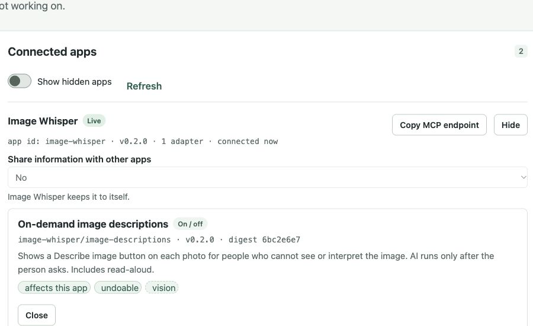

# Prototype validation

## Toolkit connection

The real event toolkit accepted the server credential and profile read. A running browser instance registered as `image-whisper` v0.2.0 with one adaptation, `image-descriptions`. It was visibly listed as Live in the console's Apps page.

The toolkit's own `adapter.mjs verify --app image-whisper` reported:

> describe ok, targets ok, query ok, check ok, apply ok, query after ok, undo ok.

The console's **Turn on / update** command was also observed enabling Describe image buttons in the app.

## Automated checks

TypeScript type checking, API validation tests, official profile-renderer mapping and adapter apply/query/revert tests pass. Tests check that the server bridge refuses profile writes, unrelated toolkit routes, other-app registration and cross-origin requests. A regression test covers the app-specific need declared to the toolkit.

## Independent code review

One independent review found three medium issues: app-specific need mapping, connection restoration after back-forward-cache navigation, and retry after initial network failure. It also found a low-priority text-size issue in the new controls. These were fixed in place. The fixes have not received a second independent review.

## Limits

This is code and integration validation, not a user study. No blind or low-vision participants have validated usefulness. Browser speech output and real assistive-technology behavior still need participant testing. AI descriptions may be wrong. Service availability and event tokens may change.
